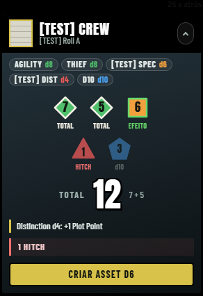

# Leverage: Liberty City — sistema para Foundry VTT v14

Sistema de jogo para o *Leverage RPG* com regras da casa inspiradas no GTA da era 3D (estrelas, Vida e Colete, Grana em
escada).



> 🚧 **Em desenvolvimento** (v0.2.0). Já roda e é testado num servidor Foundry, mas ainda não tem release pública.

## Destaques

- **Construído por agentes de IA de forma autônoma:** 87 dos 88 commits são do Claude Code. Os papéis eram separados: Sonnet implementa, Haiku faz o trabalho mecânico e Opus revisa. Um script relança a sessão sozinho quando o limite de uso acaba. Eu defini as regras do jogo, a especificação e as decisões de design, e revisei e testei nas mesas.
- **Tudo registrado:** cada etapa, decisão, problema e revisão fica em [`docs/log/`](docs/log/), com relatório final em [`docs/log/FINAL-REPORT.md`](docs/log/FINAL-REPORT.md).
- **Testado de verdade:** ~370 testes unitários em 45 arquivos (`node --test`) e testes de ponta a ponta com Playwright num servidor Foundry real, com ~480 capturas de tela como evidência ([`tests/foundry/screenshots/`](tests/foundry/screenshots/)).
- **Código:** ~14 mil linhas de JavaScript (ESM) no Foundry v14 (`ApplicationV2`, `TypeDataModel`, sockets), Handlebars e CSS. Regras puras separadas da interface, internacionalização en/pt-BR e deploy por SSH.

> Projeto de fã, sem fins lucrativos e sem ligação com os donos de *Leverage RPG* / *Cortex Prime* ou de *Grand Theft Auto*.
> O repositório não inclui texto dos livros. Para jogar, você precisa dos livros oficiais.

- **Para jogar:** leia [docs/USO.md](docs/USO.md) (instalação, ficha, rolagens, HUD, ferramentas do mestre) e
  [docs/macros.md](docs/macros.md).
- **Instalação pelo zip:** `npm run release` cria `dist/leverage-gta.zip`. Extraia-o dentro de
  `Data/systems/leverage-gta/` (o `system.json` fica direto nessa pasta) e reinicie o Foundry. Detalhes na seção 1 do
  guia de uso.

O restante deste arquivo descreve como o projeto foi construído sozinho pelo Claude Code.

## O que tem aqui

| Pasta / arquivo | O que é |
| --- | --- |
| `CLAUDE.md` | As instruções que o Claude lê toda vez que começa |
| `docs/` | Visão geral, regras, regras da casa, decisões de design, arquitetura, dados, telas, backlog, fluxo |
| `docs/log/` | **Onde você acompanha tudo:** status, progresso, decisões, problemas, revisões, relatório final |
| `reference/mockups/` | PNGs e HTML das telas (ficha, item, card de rolagem, HUD) e os arquivos-fonte do design |
| `reference/books/` | (não publicado) Texto dos livros, usado só localmente durante o desenvolvimento |
| `.claude/` | Agentes (Sonnet constrói, Haiku faz o mecânico, Opus revisa), comando `/work`, permissões |
| `scripts/run-autonomous.*` | Roda o Claude sem parar, recomeçando sozinho depois do limite de uso |
| `tools/` | Montagem do pacote (`release.mjs`) e envio para o VPS (`deploy.mjs`) |
| `system.json`, `leverage-gta.mjs` | Esqueleto: o Foundry já reconhece o sistema e você já pode criar o mundo |

## Antes de sair (uns 15–20 minutos, uma vez só)

### 1. Programas no PC

1. **Node.js LTS** (nodejs.org), **Git** (git-scm.com) e **VS Code**.
2. **Claude Code**. No PowerShell: `irm https://claude.ai/install.ps1 | iex` (ou `npm install -g @anthropic-ai/claude-code`).
3. Rode `claude` uma vez, faça login, saia com `/exit`. Depois `claude update`.

### 2. Projeto

1. Extraia **os dois zips na mesma pasta** (ex.: `C:\dev\leverage-gta`). O segundo só coloca os PDFs em
   `reference/books/`.
2. Abra a pasta no VS Code. No terminal do VS Code:
   ```powershell
   npm install -D playwright
   npx playwright install chromium
   ```

### 3. SSH sem digitar senha (a senha da chave fica só no seu PC)

Num PowerShell **como administrador**:
```powershell
Get-Service ssh-agent | Set-Service -StartupType Automatic
Start-Service ssh-agent
```
Num PowerShell normal:
```powershell
ssh-add C:\caminho\da\sua\chave.key          # digita a senha da chave uma vez
ssh -o BatchMode=yes -i C:\caminho\da\sua\chave.key usuario@ip-do-vps "echo ok"   # tem que responder "ok" sem pedir nada
```
No VPS, a pasta do sistema precisa ser gravável pelo seu usuário SSH. Se o Foundry roda com outro usuário, faça uma
vez (no VPS): `sudo mkdir -p <Data>/systems/leverage-gta && sudo chown <seu-usuario> <Data>/systems/leverage-gta`.

### 4. `.env`

Copie `.env.example` para `.env` e preencha: endereço do Foundry, mundo, usuário **Claude** e senha, dados do SSH e a
pasta do sistema no VPS. A senha de administrador do Foundry é opcional (serve para o agente relançar o mundo quando
o `system.json` mudar). **O `.env` nunca vai para o git e não sai do seu PC.**

### 5. Primeiro envio e o mundo de teste

```powershell
node tools/release.mjs --dev
node tools/deploy.mjs
```
No Foundry (navegador): volte para a tela de configuração → o sistema **Leverage: Liberty City** aparece →
crie o mundo `leverage-dev` com ele → lance o mundo → em **Configurar Jogadores**, crie o usuário **Claude**
(papel **Gamemaster**, com senha) e, se quiser, um **Tester** (Player). Deixe o mundo lançado. Não entre como
"Claude" você mesmo (o agente usa esse usuário).

Teste:
```powershell
node tests/foundry/smoke.mjs        # deve terminar com "FOUNDRY: pass"
```

### 6. Energia

Windows: Configurações → Sistema → Energia → **Suspender: nunca** (na tomada). Notebook: fechar a tampa → "nada".
O script também pede ao Windows para não suspender enquanto roda.

### 7. Começar

No terminal do VS Code, na pasta do projeto:
```powershell
powershell -ExecutionPolicy Bypass -File scripts\run-autonomous.ps1
```
(Mac/Linux: `bash scripts/run-autonomous.sh`.) Deixe o VS Code aberto. Nos primeiros minutos,
`docs/log/STATUS.md` deve mudar para `IN PROGRESS: T-001`. Pode sair.

## Como ele trabalha

- Segue `docs/10-backlog.md` tarefa por tarefa: **builders em Sonnet** em paralelo (ex.: um faz o item Job, outro o
  Asset), **Haiku** para traduções e trabalho mecânico, **Opus** revisa cada peça (código e print contra o mockup) e
  depois o conjunto de cada fase. Termina com uma revisão final completa.
- Testa no seu Foundry de verdade: envia para o VPS, entra com o usuário Claude, recarrega, abre as telas, tira prints.
- Faz commit a cada tarefa e registra tudo em `docs/log/`.
- Quando o limite de uso acaba, a sessão termina; o script tenta de novo a cada 5 minutos e recomeça **no primeiro
  momento possível**, de onde parou.
- Para quando `STATUS.md` disser `DONE` (depois da revisão final e do `FINAL-REPORT.md`).

## Quando voltar

Leia nesta ordem: `docs/log/STATUS.md` → `docs/log/FINAL-REPORT.md` (se existir) → `docs/log/PROGRESS.md` →
`docs/log/ISSUES.md` (o que precisa de você) → `docs/log/DECISIONS.md` → prints em `tests/foundry/screenshots/`.
`docs/log/runner.log` mostra cada sessão e cada espera.

## Se algo travar

| Sintoma no `runner.log` | O que fazer |
| --- | --- |
| `'claude' command not found` | Instale o Claude Code (passo 1) e abra um terminal novo |
| Pede login / "not logged in" | Rode `claude`, faça `/login`, saia e rode o script de novo |
| Bypass de permissões desativado pela organização | No script, troque `--dangerously-skip-permissions` por `--permission-mode acceptEdits --allowedTools "Bash" "Read" "Edit" "Write" "WebFetch" "WebSearch"` |
| Sessões de poucos segundos sem parar por horas | Limite de uso; é normal. Ele volta sozinho |
| `Deploy failed at: ssh …` | A chave saiu do `ssh-agent` (PC reiniciou?): rode `ssh-add` de novo. O trabalho continua sem testes no Foundry |
| Quer pausar | `Ctrl+C` no terminal. Para continuar, rode o script de novo |

Para gastar menos limite, troque `model: opus` por `model: sonnet` em `.claude/agents/reviewer.md` (a revisão fica
menos rigorosa). Para trabalhar junto com ele em vez de deixar sozinho, abra o painel do Claude no VS Code e digite
`/work` (nesse modo ele não recomeça sozinho depois do limite).
