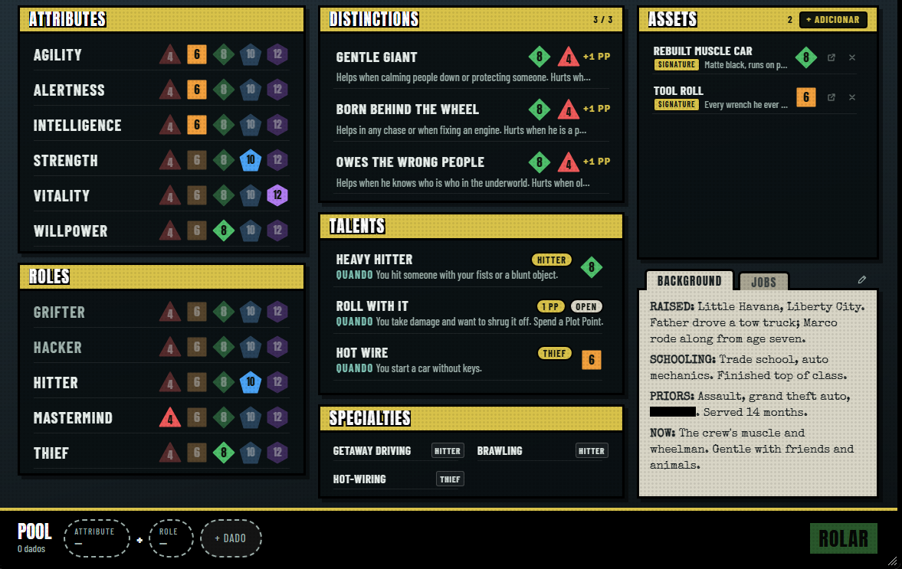

# Leverage: Liberty City — sistema para Foundry VTT v14

Sistema de jogo para o *Leverage RPG* (motor Cortex) no Foundry VTT, com regras da casa inspiradas no GTA da era 3D: estrelas de procurado, Vida e Colete, Grana em escada. Tem ficha da equipe, HUD, rolagem com card no chat, Plot Points, ferramentas do mestre e fichas de NPC e de local, em português e inglês.

> 🚧 **Em desenvolvimento** (v0.2.0). Já roda e é testado num servidor Foundry, mas ainda não tem release pública.

## Destaques

- **Construído por agentes de IA de forma autônoma:** 87 dos 88 commits são do Claude Code, com papéis separados: Sonnet implementa, Haiku faz o trabalho mecânico e Opus revisa. Um script relança a sessão sozinho quando o limite de uso acaba. Eu defini as regras do jogo, a especificação, os mockups e as decisões de design, e reviso o resultado.
- **Tudo registrado:** cada etapa, decisão, problema e revisão fica em [`docs/log/`](docs/log/).
- **Testado de verdade:** ~370 testes unitários em 45 arquivos (`node --test`) e testes de ponta a ponta com Playwright num servidor Foundry real, com ~480 capturas de tela como evidência ([`tests/foundry/screenshots/`](tests/foundry/screenshots/)).
- **Código:** ~14 mil linhas de JavaScript (ESM) no Foundry v14 (`ApplicationV2`, `TypeDataModel`, sockets), Handlebars e CSS. Regras puras separadas da interface, internacionalização en/pt-BR e deploy por SSH.

## Como os agentes trabalham

- Seguem [`docs/10-backlog.md`](docs/10-backlog.md) tarefa por tarefa: **builders em Sonnet** em paralelo (ex.: um faz o item Job, outro o Asset), **Haiku** para traduções e trabalho mecânico, **Opus** revisa cada peça (código e print contra o mockup) e depois o conjunto de cada fase.
- Testam num Foundry de verdade: enviam para o servidor, entram com um usuário de teste, abrem as telas e tiram prints.
- Fazem commit a cada tarefa e registram tudo em `docs/log/`.
- Quando o limite de uso acaba, a sessão termina; o script tenta de novo e recomeça de onde parou.

As definições dos agentes estão em [`.claude/agents/`](.claude/agents/). Para montar o ambiente e deixar o agente rodando sozinho: [docs/AGENTE-AUTONOMO.md](docs/AGENTE-AUTONOMO.md).

## Instalação

- `npm run release` cria `dist/leverage-gta.zip`. Extraia dentro de `Data/systems/leverage-gta/` (o `system.json` fica direto nessa pasta) e reinicie o Foundry.
- Como jogar (ficha, rolagens, HUD, ferramentas do mestre): [docs/USO.md](docs/USO.md) e [docs/macros.md](docs/macros.md).

## Estrutura

| Pasta / arquivo | O que é |
| --- | --- |
| `module/`, `templates/`, `styles/` | Código do sistema: regras, dados, fichas, HUD, card de rolagem |
| `system.json`, `leverage-gta.mjs` | Manifesto e ponto de entrada do sistema no Foundry |
| `tests/` | Testes unitários e de ponta a ponta (Playwright) |
| `docs/` | Regras, regras da casa, decisões de design, arquitetura, dados, telas, backlog |
| `docs/log/` | Diário do desenvolvimento: status, progresso, decisões, problemas, revisões |
| `reference/mockups/` | Mockups das telas (ficha, item, card de rolagem, HUD) |
| `CLAUDE.md`, `.claude/` | Instruções e agentes do Claude Code, comando `/work` |
| `scripts/run-autonomous.*` | Roda o Claude sem parar, recomeçando depois do limite de uso |
| `tools/` | Montagem do pacote e deploy no servidor |

## Aviso

Projeto de fã, sem fins lucrativos e sem ligação com os donos de *Leverage RPG* / *Cortex Prime* ou de *Grand Theft Auto*. O repositório não inclui texto dos livros: para jogar, você precisa dos livros oficiais.
