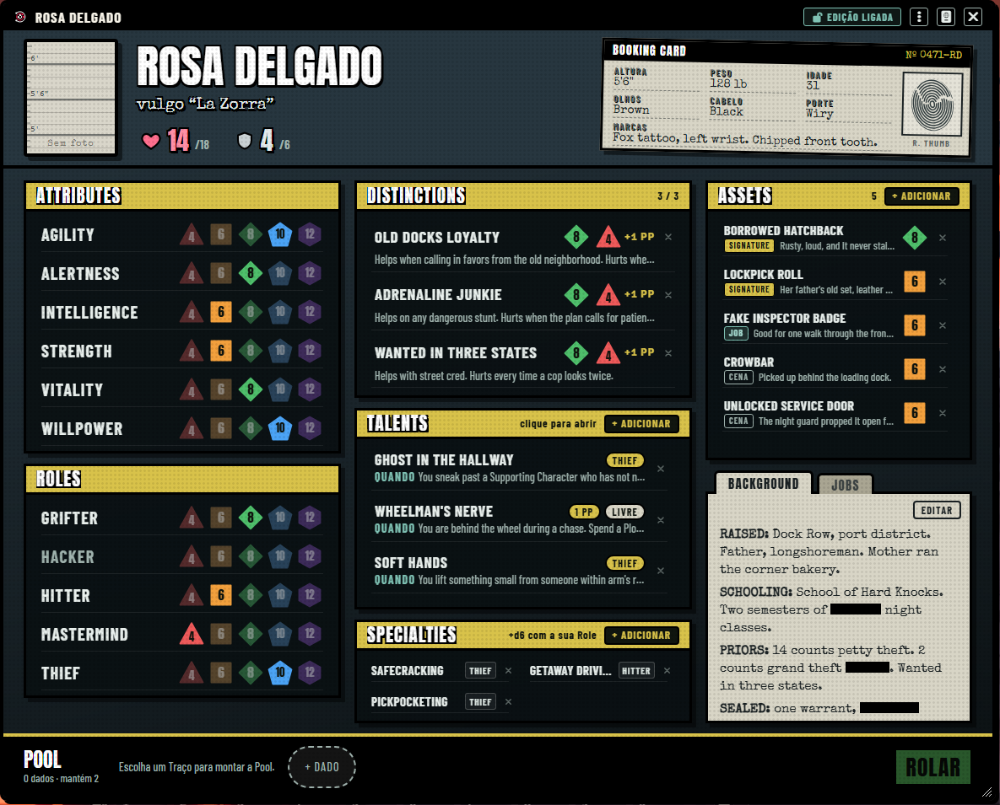
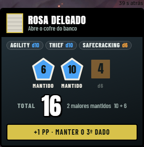
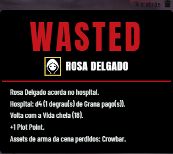
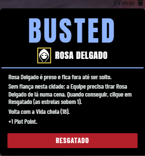
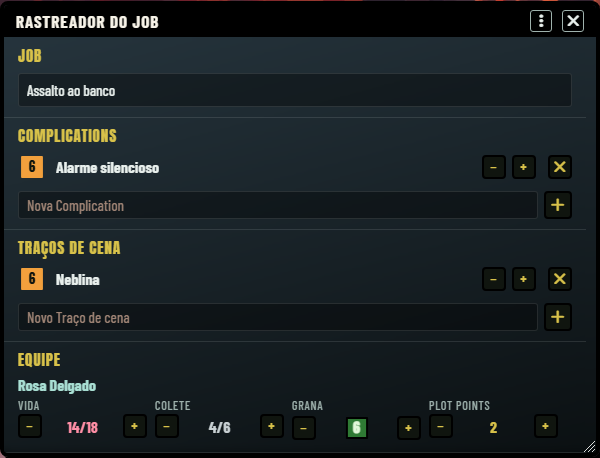
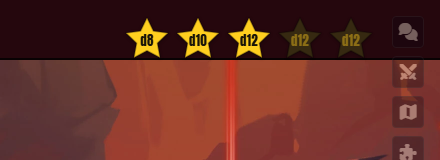

# Leverage: Liberty City — guia de uso

Guia rápido para o mestre (o **Fixer**) e para os jogadores. O sistema roda o *Leverage RPG* (Cortex Plus) no
Foundry VTT v14 e acrescenta três regras da casa inspiradas no GTA da era 3D: **Estrelas**, **Vida e Colete** e
**Grana em escada**. Cada regra da casa liga e desliga nas configurações; com as três desligadas, o jogo é o Leverage
puro. Os nomes do livro (Distinction, Talent, Asset, Complication, Plot Point, Job) ficam em inglês, como no sistema.

Sumário: [Instalação](#1-instalação) · [Começando](#2-começando-o-mundo-e-a-equipe) · [Rolar a Pool](#3-rolar-a-pool) ·
[Plot Points](#4-plot-points) · [Estrelas](#5-estrelas-de-procurado) · [Vida e Colete](#6-vida-e-colete) ·
[Grana](#7-grana) · [Wasted e Busted](#8-wasted-e-busted) · [Jobs](#9-jobs-e-rastreador) · [HUD](#10-o-hud) ·
[Ferramentas do mestre](#11-ferramentas-do-mestre) · [Compêndio](#12-compêndio-de-exemplo) ·
[Configurações](#13-configurações) · [Macros](#14-macros) · [Problemas comuns](#15-problemas-comuns)

---

## 1. Instalação

O sistema ainda não tem endereço de manifesto publicado. Instale pelo zip:

1. Gere ou baixe `leverage-gta.zip` (no repositório: `npm run release` cria `dist/leverage-gta.zip`).
2. No computador que roda o Foundry, abra a pasta de dados (`Data/systems/`) e crie uma pasta `leverage-gta`.
3. Extraia o zip **dentro** dela: o arquivo `system.json` tem que ficar direto em `Data/systems/leverage-gta/`.
4. Reinicie o Foundry, ou volte à tela de configuração. O sistema aparece em **Game Systems** como
   *Leverage: Liberty City*.

Quando houver um endereço de manifesto, vale o caminho normal: **Game Systems → Install System → Manifest URL**.

Requisitos: Foundry **v14**. O sistema vem em inglês e português do Brasil (o Foundry usa o idioma de cada usuário).
O módulo *Dice So Nice*, se estiver ativo, ganha dados nas cores do sistema; sem ele, nada muda. (A integração
ainda não foi testada com o módulo ativo.)

## 2. Começando: o mundo e a Equipe

**Mestre**

1. Em **Worlds**, crie um mundo escolhendo o sistema *Leverage: Liberty City* e entre nele.
2. Em **Actors**, crie um ator do tipo **Crew** (a Equipe, os personagens dos jogadores). Os outros tipos são **NPC**
   (Extra, Foil, Mark, Agent) e **Location** (Local, com Traços e uma cidade). A cidade do Local é só
   informativa. A cidade atual da mesa é uma só (a do Nível de procurado): ela vale para as estrelas do HUD e para o
   atalho *Polícia* do Rolador de oposição.
3. Dê a cada jogador a posse (**Owner**) do seu personagem e, em **Configure Players**, escolha o personagem de cada
   usuário. O HUD usa esse personagem.
4. Atalho: importe a **Rosa Delgado** do compêndio (seção 12) e use como modelo.

**Ficha da Equipe**

- **Cabeçalho:** retrato (clique para trocar), nome, apelido, **Vida** (coração) e **Colete** (escudo). Clique num
  deles para ajustar com − e +; no Colete escolha o tipo (Leve 4, Comum 6, Pesado 10). À direita, o **Booking Card**.
- **Attributes** (6) e **Roles** (5): cada linha é uma escada de d4 a d12. Uma Role pode ficar em branco, e uma Role em
  branco não entra na Pool.
- **Distinctions** (até 3), **Talents**, **Specialties** e **Assets** com o botão **+ Adicionar**. Cada item abre na
  própria janela ao clicar.
- **Background** (texto livre) e **Jobs** (o histórico de golpes) numa pasta com duas orelhas.
- **Trava de Traços:** com a trava ligada (padrão), os jogadores não mudam Attributes, Roles, Distinctions, Talents nem
  Specialties. O selo na barra do título mostra o estado. Quem tem só permissão de observador vê a ficha sem controles.

## 3. Rolar a Pool

A bandeja **POOL** fica no rodapé da ficha.

1. Clique no nome de **um Attribute** e de **uma Role** (obrigatórios; escolher outro troca o anterior). Sem os dois, o
   botão ROLAR fica desligado.
2. Se quiser, some: uma **Distinction** (no máximo uma; o d8 ajuda, o d4 atrapalha e dá +1 Plot Point), uma
   **Specialty** (+d6, vale com a Role dela), **Assets** e **Talents** com dado, e dados avulsos pelo **+ DADO** (d4 a d12, a **Grana**, se a regra
   estiver ligada, e os Traços de cena do Job ativo).
3. Clique em um chip para tirá-lo da Pool. **ROLAR** (ou Enter, com a ficha em foco) rola tudo.

**Regra:** rola todos os dados e soma os **dois maiores**. Dado que tirou **1** não conta; se todos tirarem 1, o total
é 0. Fica tudo no card do chat:

- Dados **mantidos** têm borda acesa; os **1** aparecem em vermelho (*1 · Fora*); os demais ficam apagados.
- **+1 PP · Manter o 3º dado** (só o dono, nunca o mestre): gasta 1 PP e soma o próximo maior dado. Dá para repetir.
  Só aparece no card **mais recente** do personagem e enquanto sobra dado; sem Plot Points o botão fica apagado.
- **Mestre · Complication** (só o mestre, quando há um 1): cria ou sobe uma Complication no Job ativo e **dá 1 Plot
  Point** ao jogador. É escolha do mestre, não é automático.
- Dado de **Grana** na Pool faz a Grana descer 1 degrau, e Distinction d4 dá +1 PP; o card avisa de ambos.

**Rolagem do mestre (oposição):** botão **Rolador de oposição** nas ferramentas do mestre. Escolha dados avulsos ou
atalhos (nenhuma oposição = 2d6, Polícia pelas estrelas atuais, Gangue N × dX, um NPC, Traços do Local e Complications
do Job) e role. O card sai com o cabeçalho **MESTRE**.

**Contra um jogador:** o jogador precisa fazer **mais** que o mestre; empate é do mestre. Passar por 5 ou mais é
sucesso extraordinário. O sistema mostra os totais, mas quem decide o resultado é a mesa.

## 4. Plot Points

- Cada jogador começa um Job com **1 PP** (configurável): **Novo Job** leva cada um a *pelo menos* esse número. Quem
  tem mais Plot Points guarda os seus; nada é somado por cima.
- **Ganha:** Distinction d4 na rolagem; Complication criada pelo mestre a partir de um 1 seu; ao desistir (Give In, manual: o mestre cria a Complication
  e usa **Dar Plot Point**);
  ao ser Wasted ou Busted; PP dados pelo mestre (**Dar Plot Point**).
- **Gasta:** manter mais um dado depois da rolagem (botão do card); criar um **Asset de cena** (1 PP) ou de **Job**
  (2 PP) pelo botão **+ Adicionar** da lista de Assets, que mostra o custo e pede confirmação; ativar Talents que
  custam 1 PP (o sistema não desconta sozinho: tire o PP à mão pelo − do HUD).
- No HUD, o − gasta 1 PP manualmente e o clique direito no número também. Só o mestre soma pelo HUD.

## 5. Estrelas de procurado

As estrelas (0 a 5) medem o quanto a polícia está atrás da Equipe **numa cidade**. São do grupo e **só o mestre
mexe**: clique nas estrelas do HUD (a estrela N define o nível N; clicar na do nível atual baixa um) ou use
**Nível de procurado** nas ferramentas do mestre, que também escolhe a cidade. Cada mudança é anunciada no chat.
Trocar de cidade zera as estrelas (a Equipe saiu de lá) e também aparece no chat.
  As estrelas são ações só do mestre: o sistema recusa qualquer outro usuário e não há socket para elas.

- **Sobem** (1 por vez): ser visto cometendo crime, tiro em público, ferir ou matar policial, ataque grande ou fuga de
  prisão. Falhar numa fuga não sobe estrela.
- **Dado da polícia:** quando a polícia atrapalha, o mestre rola a **Pool da estrela atual** (atalho *Polícia* no Rolador
  de oposição). Cada estrela do HUD mostra o dado principal e o tooltip mostra a Pool inteira.
- **Cidades:** Carcer City, Las Venturas e Liberty City, cada uma com a sua Pool por estrela e as suas regras para
  baixar o nível (esperar fora de vista, mudar de cara, comprar silêncio, última saída). Tudo editável em
  **Escalas das cidades** (seção 13). Em Liberty City, por exemplo, comprar silêncio não funciona.
- As estrelas **não zeram sozinhas**, mas trocar a cidade atual na janela **Nível de procurado** (ou com
  `stars.set(nivel, cidade)`) zera o nível e posta uma linha de ESTRELAS no chat.
- A janela **Nível de procurado** tem os botões de ação, todos seguindo as regras da cidade atual: **subir**
  (com motivo), **esperar** (por cena ou entre sessões), **disfarce** (só roupa ou carro e roupa), **silêncio**
  (paga dados de Grana do personagem escolhido) e **última saída** (pede confirmação). Os mesmos atalhos existem na API
  (seção 14: `stars.wait`, `stars.disguise`, `stars.buySilence`, `stars.lastResort`).

## 6. Vida e Colete

- **Vida máxima = 10 + o dado de Vitality** (d8 dá 18). O número base é configurável.
- **Colete:** pontos que absorvem dano antes da Vida (Leve 4, Comum 6, Pesado 10). Com 0, acabou.
- **Inimigos não têm barra: são dados.** Cada capanga é um dado (4 capangas d8 = 4d8, soma dos dois maiores).
- **Rodada de tiroteio:** o jogador rola contra os dados da gangue. Se passa, o mestre derruba um capanga (dois se
  passar por 5 ou mais) diminuindo o tamanho da gangue na ficha do NPC: o sistema não faz isso sozinho. Se perde ou
  empata, leva dano = **quanto perdeu por + o dado da arma** do inimigo.
- **Aplicar dano:** no card de oposição do mestre, o botão **APLICAR DANO** escolhe o alvo, rola o dado da arma, pergunta
  pela **cobertura** (divide o dano pela metade, arredondando para baixo), tira primeiro do **Colete** e depois da
  **Vida**. Está em `docs/02-regras-da-casa.md` e vale só em luta de verdade; discussões e golpes seguem o livro.
- **Desistir** antes de rolar (Give In): a pessoa sai com uma Complication leve (*Bloodied d6*) e ganha 1 PP. É
  manual: o mestre cria a Complication no Rastreador e usa **Dar Plot Point**.
- **Recuperar:** cena de descanso devolve metade da Vida máxima, um dia entre golpes devolve tudo, tratamento médico
  custa d4 de Grana e devolve tudo. No diálogo **Pagar**, **Hospital** paga e devolve toda a Vida, e os itens de
  **colete** pagam e colocam o colete novo, cheio. Cena de descanso e dia entre golpes (`restScene()`, `restDay()` no
  personagem) não têm botão no diálogo: use macro ou ajuste a Vida e o Colete direto na ficha ou no Rastreador.
- A Vida é a barra principal do token e o Colete é a secundária.

## 7. Grana

O dinheiro é um número de **degraus** (0 a 25) mostrado como dados verdes: d4 = 1 degrau, d6 = 2, d8 = 3, d10 = 4,
d12 = 5. Um d12 cheio vale 5 degraus e o maior dado fica à direita (7 degraus = d6 · d12). Todo personagem começa com
2 degraus (d6).

- **Preços são dados:** d4 = 1, d6 = 2, d8 = 3, d10 = 4, d12 = 5; combinações somam. Pagar desce os degraus. Faltou
  Grana, não compra (ou pede emprestado).
- **Pagar:** clique no `$` do HUD. Abre a tabela de preços (hospital, fiança, coletes, aluguéis, imóveis, Signature
  Asset…) ou um preço livre em dados. Coisa barata (táxi, lanche) é grátis para quem tem qualquer dinheiro.
- **Emprestar:** clique direito no `$`; escolha quem recebe e quantos degraus.
- **Na Pool:** o maior dado de Grana entra como qualquer outro, e depois da rolagem a Grana **desce 1 degrau**, passando
  ou não. Só um dado de Grana por rolagem.
- **Ganhar:** o pagamento de um Job (**Encerrar Job**, seção 9) e o ajuste do mestre no Rastreador. Uma referência da
  regra: golpe pequeno 4 degraus, médio 8, grande 12, divididos pela Equipe; um bico na cidade rende +1.
- O mestre pode editar a tabela de preços em **Tabela de preços** (seção 13).

## 8. Wasted e Busted

Quando o **dano leva a Vida a 0**, o sistema posta um card no chat com os passos (o mestre confirma no diálogo). O card
sai pelo **APLICAR DANO** ou por `combat.applyDamage`/`combat.down`; baixar a Vida à mão com o − da ficha não
dispara nada:

- **WASTED** (derrubado por quem não é polícia): acorda no hospital, paga **d4 de Grana** (1 degrau), volta com a Vida
  cheia, **ganha 1 PP** e perde os Assets de arma de **cena**.

- **BUSTED** (derrubado pela polícia): é preso e fica fora até sair, volta com a Vida cheia, **ganha 1 PP** e perde os
  Assets de arma de cena. A saída é a **fiança** (d6 de Grana, no fim da cena) ou o **resgate** (a Equipe tira a pessoa
  numa cena; é fuga de prisão e sobe 1 estrela). Em Liberty City a fiança não funciona, então só o resgate vale. O
  botão **Resgatado** do card faz o resgate.
- Morte só acontece se a mesa decidir.

## 9. Jobs e Rastreador

Um **Job** é um golpe completo.

- **Novo Job** (ferramentas do mestre): dá o nome, inicia o Job ativo, limpa as Complications antigas e dá os Plot
  Points iniciais aos personagens que têm jogador.
- **Rastreador do Job:** abre a janela com o nome do Job, as **Complications** (nome e dado; subir, descer, remover), os
  **Traços de cena** e a **Equipe** (Vida, Colete, Grana e Plot Points de cada um, com − e +).

- **Encerrar cena:** apaga os Assets de cena da Equipe (com confirmação) e limpa os Traços de cena.
- **Encerrar Job:** pede o nome, o rendimento total em degraus e a parte de cada um. Cria um Job no histórico de cada
  ficha, soma a Grana e apaga os Assets de Job.
- **Nova sessão:** devolve o **Callback** de todos os Jobs.
- **Aba JOBS da ficha:** lista cada Job concluído com a parte do personagem. Marque o **Callback** para citar um Job
  (só marca e anuncia no chat; vale como um Plot Point gasto na rolagem, uma vez por Job por sessão, e a mesa aplica
  o efeito). **Train up** gasta Jobs sem uso para ganhar
  Signature Asset, Specialty, Talent (1 Job cada) ou um degrau de Attribute ou Role (2 Jobs cada); os custos são
  editáveis. Job gasto continua no histórico, mas não serve mais para Callback. **+ Registrar** cria um Job à mão.

## 10. O HUD

Fica no canto superior direito, ao lado da barra lateral.

- **Estrelas:** cinco estrelas, cada uma com o dado principal da cidade. Só o mestre clica.
- **Grana:** o `$` e os dados verdes. Clique para pagar; clique direito para emprestar.
- **Plot Points:** a ficha amarela com o número, mais o − (e o + para o mestre).
- Mostra o personagem do usuário. O mestre vê a Grana e os PP do token selecionado; sem personagem, aparecem apagados.
- **Shift + clique** no `$` minimiza o HUD (só as estrelas); para restaurar, passe o mouse sobre o HUD minimizado e
  clique no botão que aparece. Cada jogador pode esconder estrelas, Grana ou Plot Points
  nas configurações de cliente. Estrelas e Grana somem quando a regra da casa está desligada.
- Na imagem acima, o mestre está sem token selecionado: aparecem só as estrelas.

## 11. Ferramentas do mestre

Na barra de controles à esquerda, o grupo **Leverage** (só o mestre vê):

| Ferramenta | O que faz |
| --- | --- |
| Trava de Traços | Liga e desliga a trava e avisa no chat |
| Nível de procurado | Define estrelas e cidade |
| Rolador de oposição | Rolagens do mestre (seção 3) |
| Rastreador do Job | A janela da seção 9 |
| Encerrar cena | Apaga Assets de cena (confirma) |
| Novo Job | Inicia um Job |
| Encerrar Job | Registra o Job, paga a Equipe |
| Nova sessão | Devolve os Callbacks |
| Dar Plot Point | Escolhe quem recebe 1 PP |

## 12. Compêndio de exemplo

Em **Compendium Packs** há quatro pacotes: **Equipe de exemplo**, **NPCs**, **Locais** e **Talents e Assets**.

- A **Rosa Delgado** (Equipe) é uma personagem completa para olhar e copiar: Thief d10 como Role primária, três
  Distinctions, três Talents, Specialties, cinco Assets, nove Jobs (três já gastos), Background e Booking Card.
  Importe com o botão direito ou arrastando para a lista de atores.
- Os cinco NPCs (gangue de rua, esquadrão de choque, tenente Ines Calder, Silas Kane e Victor Brandt), o Local e os
  Talents e Assets são exemplos próprios para copiar e editar. O conteúdo do livro não vem no sistema.

## 13. Configurações

Engrenagem → **Configure Settings** → **System Settings** → *Leverage: Liberty City*.

**Do mundo (só o mestre):**

| Configuração | O que faz | Padrão |
| --- | --- | --- |
| Estrelas de procurado | Liga as estrelas (HUD, dado da polícia) | ligada |
| Vida e Colete | Liga Vida, Colete e dano | ligada |
| Grana em escada | Liga a Grana (HUD, bandeja, preços, hospital e fiança) | ligada |
| Vida base | Vida máxima = isto + Vitality | 10 |
| Grana inicial | Degraus de novos personagens | 2 |
| Plot Points por Job | PP de cada um em Novo Job | 1 |
| Trava de Traços | Trava a edição dos Traços pelos jogadores | ligada |
| Escalas das cidades | Menu: cidades e Pool de cada estrela | |
| Tabela de preços | Menu: preços em dados | |
| Custos de treinamento | Menu: Jobs que cada Train up custa | |

**Do cliente (cada usuário):** mostrar Estrelas, Grana e Plot Points no HUD; manter a Pool depois de rolar (padrão: a
Pool limpa); log de depuração no console.

## 14. Macros

Tudo o que as ferramentas e a ficha fazem também está em `game.leverage`. Veja **[docs/macros.md](macros.md)**: rolar
uma Pool por macro, Grana, estrelas, Plot Points, Jobs, dano. Arrastar um Attribute, Role, Specialty, Asset ou Talent da
ficha para a barra de atalhos cria uma macro que põe aquele Traço na Pool.

## 15. Problemas comuns

- **O HUD não aparece ou está vazio.** Confira as configurações de cliente (partes escondidas) e se as regras da casa
  estão ligadas. Sem personagem atribuído, a Grana e os Plot Points aparecem apagados com o aviso "Nenhum personagem
  atribuído".
- **O jogador não consegue mudar os Traços.** É a **Trava de Traços**. O mestre destrava nas ferramentas ou nas
  configurações.
- **ROLAR está desligado.** Falta um Attribute ou uma Role, ou a Role escolhida está em branco.
- **O botão +1 PP não aparece (ou está apagado).** Sem Plot Points ele fica apagado; some se não resta dado para manter
  (os 1 não valem), se o card não é o mais recente do personagem ou se quem olha é o mestre.
- **Grana insuficiente.** Faltam degraus; o diálogo informa quantos. Empreste de outro personagem ou ajuste a Grana.
- **Não consigo mexer nas estrelas.** Só o mestre. Se estiverem escondidas, a regra Estrelas está desligada.
- **Mudei o `system.json` ou instalei uma versão nova e nada mudou.** Volte à tela de configuração e lance o mundo de
  novo. Mudanças só em CSS, templates e idiomas bastam com F5.
- **Uma macro avisa e não faz nada.** Os erros de uso viram um aviso na tela. Confira o nome do personagem e se a ação é
  só do mestre.
- **Texto em inglês na interface.** Troque o idioma do Foundry para *Português (Brasil)* em Configure Settings.
